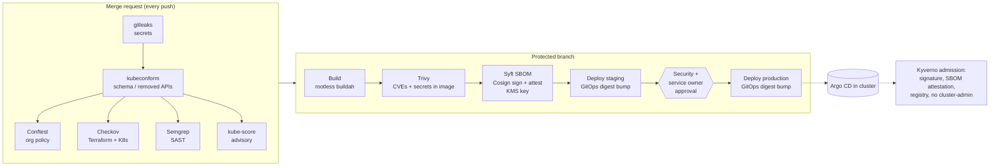

# Shift-Left Pipeline & Software Supply Chain (Module 2)

## 1. Why the ClusterRoleBinding got through

The `cluster-admin` binding on a CI service account (F-01) wasn't one missing scanner. Four things were missing at once:

| Gap | Consequence |
|---|---|
| No policy check on manifests before merge | Nobody was asked "should a CI job be cluster-admin?" |
| CI held long-lived cluster credentials | Anything that runs in CI can act on the cluster directly |
| No admission control in the cluster | Even a manual `kubectl apply` would have been accepted |
| Audit logging off (F-16) | It was found by an audit, not by an alert |

So the design closes it at four layers, and any one of them on its own would have stopped or exposed this incident:

1. **Pre-merge:** a Conftest policy fails the MR (demonstrated against the real manifest in [§9](#9-proof-this-catches-the-incident)).
2. **Identity:** CI never holds cluster credentials. Deployment is GitOps: CI writes an image digest to an environment repo, and Argo CD in the cluster applies it under a namespace-scoped `AppProject`.
3. **Admission:** Kyverno refuses `cluster-admin` bindings however they arrive ([`policies/kyverno/cluster-guardrails.yaml`](policies/kyverno/cluster-guardrails.yaml)).
4. **Detection:** the EKS audit log alerts on any new `cluster-admin` binding (Module 3).

## 2. Pipeline flow

## 3. Gates

| Stage | Tool | What it checks | Fail mode | Findings |
|---|---|---|---|---|
| secrets | **gitleaks** | Credentials in the diff and the MR's commit history | **Hard** | F-05, F-11 |
| validate | **kubeconform** | Manifests (and CRDs) valid against the target EKS version's schemas, 1.36 today; catches removed APIs before an upgrade does | **Hard** | F-29 |
| static | **Conftest (OPA)** | Org rules: no `cluster-admin` or `*` RBAC, no `escalate`/`bind`, no privileged/host namespaces/hostPath/runtime socket, digest-pinned images, no NodePort, nothing in `default`, no Secret values in Git | **Hard** on `deny`, soft on `warn` | F-01, F-02, F-03, F-04, F-08, F-10, F-11, F-17, F-27 |
| static | **Checkov** | Terraform and K8s misconfiguration; hard-fail on a curated list (public EKS endpoint, control-plane logging, secrets encryption, ECR immutability/KMS, privileged, host PID/network, docker socket) | **Hard** on curated list, soft otherwise | F-15, F-16, F-23, F-25, F-02, F-03 |
| static | **Semgrep** | Registry packs, plus three organisation rules: shell command built from input, request data reaching a child process (SSRF), Flask debug mode | **Hard** on ERROR | F-03, F-09, F-10 |
| static | **kube-score** | Reliability hygiene: probes, PDBs, anti-affinity | Soft | F-21 |
| image | **Trivy** | OS and library CVEs; secrets in image layers | **Hard** on fixable Critical and any secret; soft on High | F-05, F-26 |
| supply chain | **Syft** | CycloneDX SBOM of the *built image* | Must succeed | F-17 |
| supply chain | **Cosign** | Signature + SBOM attestation, signed with an AWS KMS key | Must succeed | F-17, F-24 |
| release | **GitLab protected environment** | Named approvers before production | Blocking | All |
| admission | **Kyverno + PSA** | Signature and attestation verified, registry allowlist, no `cluster-admin`, limits required, PSA `restricted` | **Enforce** | F-01, F-02, F-06, F-14, F-17, F-21 |

**Why two policy engines (Conftest and Checkov)?** Checkov is a broad, maintained catalogue, but it's generic. Conftest holds *our* rules, written for *our* incidents, versioned in a central repo the app teams can't edit in the same MR. Having both is cheap; relying on a vendor catalogue alone is how a cluster-admin binding stays unflagged (see the coverage note in [`../01-findings/evidence/`](../01-findings/evidence/)). Code scanning showed the same pattern: Semgrep's registry packs missed the command injection and the SSRF and rated Flask debug mode only a warning, so three organisation rules ([`policies/semgrep/org-rules.yaml`](policies/semgrep/org-rules.yaml)) now catch all three, and stay quiet on the corrected code. (tfsec isn't in the list: Aqua has moved its checks into Trivy and recommends migrating.)

## 4. Hard-fail vs soft-fail

The rule I'd defend to a delivery team: **hard-fail when the finding gives an attacker a path, and the fix is in the developer's hands today.** Everything else reports, gets tracked, and has a date.

- **Hard:** secrets, cluster-wide RBAC, privileged/host access, unsigned or unpinned images, fixable Critical CVEs, public control plane. These are the Critical/High findings from Module 1, and each has a known, small fix.
- **Soft, with a ratchet:** `runAsNonRoot`, `readOnlyRootFilesystem`, High CVEs, missing requests. These are right, but some images need rework to comply. Blocking on day one would stop releases for reasons teams can't fix that day, and teams would learn to route around the pipeline. So they warn for 60 days and then become hard-fail on a date published at the start.
- **Soft, permanently:** kube-score reliability hints. Useful, but not security, and not worth blocking a release over.
- **Unfixed CVEs** (`--ignore-unfixed`): never block. Blocking on something nobody can fix only teaches people to ignore red pipelines.

**Admission moves on the same dates**, so the pipeline and the cluster never disagree: from go-live, Pod Security enforces `baseline` (which already blocks privileged pods, host namespaces and `hostPath`) and only *warns* on `restricted`; Kyverno's requests-and-limits and pod-security rules run in `Audit`. On the ratchet date, all three switch to enforce together.

**Exceptions** live in a `security-exceptions.yaml` in the app repo: finding ID, justification, compensating control, owner, expiry date (max 90 days). The file is CODEOWNERS-protected by the security team, and the pipeline fails when an exception has expired. Exceptions are visible, owned and time-boxed, and the risk forum reviews them monthly.

**Speed budget:** MR stage under 5 minutes. Every static job runs in parallel; Trivy uses a cached DB; Checkov and Conftest run on changed paths in MRs and on the full repo nightly. A pipeline people wait 20 minutes for gets bypassed.

## 5. Security sign-off before production

`production` is a GitLab **protected environment** with a deployment approval rule: one approver from `@platform-security` and one from the service owner group; self-approval disabled. The approver sees the MR security widget, the Trivy report and the SBOM. Protected environments with approvals are a GitLab Premium feature on self-managed. If the instance is on the free tier, the fallback is a `when: manual` job that only members of a protected group can run, plus CODEOWNERS approval on the environment repo's production path.

The approval should become light over time. As the gates mature, security approval moves from "review every release" to "review exceptions and changes to the gates themselves". That is where the velocity gain comes from.

## 6. SBOM: generated, stored, used

| | |
|---|---|
| **Generated** | Syft, CycloneDX JSON, from the built image (not the source tree), so it lists what actually ships including OS packages. |
| **Stored** | (1) As a Cosign attestation in ECR, next to the image digest, so it travels with the image. (2) As a GitLab artifact kept for 1 year. (3) Uploaded to **Dependency-Track**. |
| **Used** | (1) Kyverno requires the attestation at admission, so no SBOM means no deploy. (2) Dependency-Track re-evaluates every running image's SBOM against new CVEs daily, which catches "new CVE in something already in production" without a rebuild. (3) Incident response: "which workloads ship library X version Y?" is a query, not an investigation. |

An SBOM nobody reads is compliance paperwork. Point (2) is what makes it worth generating.

## 7. Signing and admission-time verification

- **Sign:** `cosign sign` with a key held in **AWS KMS** (`awskms:///alias/ci-image-signing`). The private key never exists on a runner. The CI role can call `kms:Sign` only from protected-branch pipelines (enforced by the OIDC `sub` condition on the role trust policy).
- **Verify:** Kyverno `verifyImages` checks the signature and the CycloneDX attestation against the public key exported from KMS and embedded in the policy, then rewrites the tag to the digest (`mutateDigest`) so what's admitted is what runs.
- **Why key-based and not keyless Sigstore?** Keyless signing writes signer identity and image metadata to the *public* Rekor transparency log and depends on public Fulcio. For a government programme, publishing internal build metadata to a public log is likely a data classification problem, and the clusters may not be able to reach public Sigstore. The trade-off: we own key rotation and custody. KMS makes that manageable: annual rotation, with old public keys kept in the Kyverno policy until images signed with them age out. If a private Sigstore deployment becomes available later, switching is a policy change.

## 8. Provenance (SLSA): what it adds and what's proportionate

The SBOM says *what* is in the image. The signature says *we* approved it. Provenance says *how it was built*: which source commit, which pipeline, which builder. That's what would show a tampered build, e.g. an image built from a commit that never went through MR review.

**Recommendation: SLSA Build Level 2 now, Level 3 as a 2-quarter target.**

- **L2 now:** GitLab's runner can produce an SLSA provenance statement for *job artifacts* (`RUNNER_GENERATE_ARTIFACTS_METADATA`), but that statement isn't signed on its own and doesn't cover an image pushed to a registry. So the pipeline writes a provenance predicate for the image from CI variables (source commit, pipeline, runner) and signs it with the same KMS key as a Cosign attestation. Cheap, and it gives a signed audit trail from image digest back to commit.
- **L3 later:** L3 needs the provenance to be unforgeable by the build itself, which means hardened, isolated, ephemeral runners where one job can't influence another or touch the signing material. The estate has shared group-level runners today. Getting to L3 is mostly runner platform work, and that work is worth doing anyway: it's the single biggest pipeline risk. Claiming L3 on shared runners would be paperwork rather than security.
- **Proportionality:** these workloads were containerised in a hurry, and the team is still learning to work with policy gates. Adding provenance verification at admission *now* would add a failure mode they can't easily debug. So: generate and store provenance now; *verify* it at admission once the runner work lands.

## 9. Proof this catches the incident

Tested, not just designed. Full output and the script are in [`../01-findings/evidence/`](../01-findings/evidence/).

| Tool, against kubernetes-goat's real `scenarios/insecure-rbac/setup.yaml` | Result |
|---|---|
| **Conftest with this folder's policy** (pre-merge gate) | `FAIL ... [F-01] ClusterRoleBinding/superadmin binds cluster-admin`: **blocks the merge** |
| **Kyverno with this folder's policy** (admission) | `cluster-admin bindings are not allowed (F-01)`: **blocks the apply** |
| Checkov 3.3.19 (generic catalogue) | **No finding.** Its RBAC checks read Role contents, and `cluster-admin` never appears in the manifest |
| Trivy 0.74.0 (generic catalogue) | `KSV-0111`, rated **Medium**: passes a typical "fail on High/Critical" gate |

That's the case for an organisation-owned policy in one table: the two generic scanners would have let the audit finding through, and the rule written for our own incident stops it at both merge and admission.

Testing also caught a bug in my own admission policy: with `background: true`, Kyverno silently skipped the `cluster-admin` rule (subject-based exclusions aren't allowed in background scans). It's now admission-only. Policies get tested like code, with known-bad and known-good manifests, in the policy repo's own pipeline.

## 10. Securing the pipeline itself

The pipeline is now the most privileged thing in the delivery path, so:

- **Runners:** ephemeral Kubernetes runners, unprivileged, no Docker-in-Docker (builds use rootless buildah). Separate runner pool, tagged, for protected branches so MR code from any branch never runs where signing credentials are reachable.
- **Credentials:** no static cloud keys. GitLab OIDC `id_tokens` → short-lived role; trust policy pinned to project path and protected ref.
- **Tool images pinned by digest**, updated only by Renovate MRs that a human reviews, with a **~14-day cooldown** before any new release is adopted. In March 2026 the `aquasec/trivy` `latest` and `0.69.4-0.69.6` tags served a credential stealer for about three days, and in April the `checkmarx/kics` tags did the same. A pipeline pulling `trivy:latest` would have handed its CI secrets to an attacker *while running a security scan*. Digest pinning plus no long-lived secrets in CI means that class of attack gets little.
- **Policies** are in a central repo with CODEOWNERS = security; app pipelines pull them at a pinned ref. The policy repo has its own pipeline that runs every policy against known-bad and known-good manifests (as in `tools/run-scans.sh`).
- **Known upgrade item:** Kyverno 1.19 deprecates `kyverno.io/v1 ClusterPolicy` in favour of CEL-based `ValidatingPolicy`. The policies here work today; migrating them is planned work, not a go-live blocker.
- **Branch protection:** main is protected, MRs need approval, force-push disabled, and pipeline configuration changes need a security CODEOWNER review.

## 11. Other clouds

The design is deliberately cloud-agnostic above the identity and registry layers.

| Component | EKS (today) | AKS | GKE | Changes? |
|---|---|---|---|---|
| Conftest, Checkov (K8s), Semgrep, gitleaks, kubeconform | same | same | same | No |
| Kyverno policies, PSA labels | same | same | same | Only the registry hostname in one policy |
| Checkov (IaC) | `terraform` AWS checks | Azure checks | GCP checks | Same tool, different curated hard-fail list |
| Registry | ECR | ACR | Artifact Registry | Push target + IAM |
| Signing key | `awskms://` | `azurekms://` | `gcpkms://` | Cosign supports all three; Kyverno trusts multiple keys |
| CI → cloud auth | GitLab OIDC → AWS STS | → Entra workload identity federation | → GCP Workload Identity Federation | Same pattern, different trust config |
| Deploy | Argo CD | Argo CD | Argo CD | No |

The one decision to make before AKS/GKE onboard: **one signing key per cloud, or one central key** trusted by all clusters. I'd go with one key in the primary cloud's KMS: one trust root to govern, and every cluster verifies the same signatures. The cost is a cross-cloud dependency at admission time. That's mitigated by Kyverno verifying against the *public* key, which is distributed in the policy, so the KMS isn't called at admission at all.
