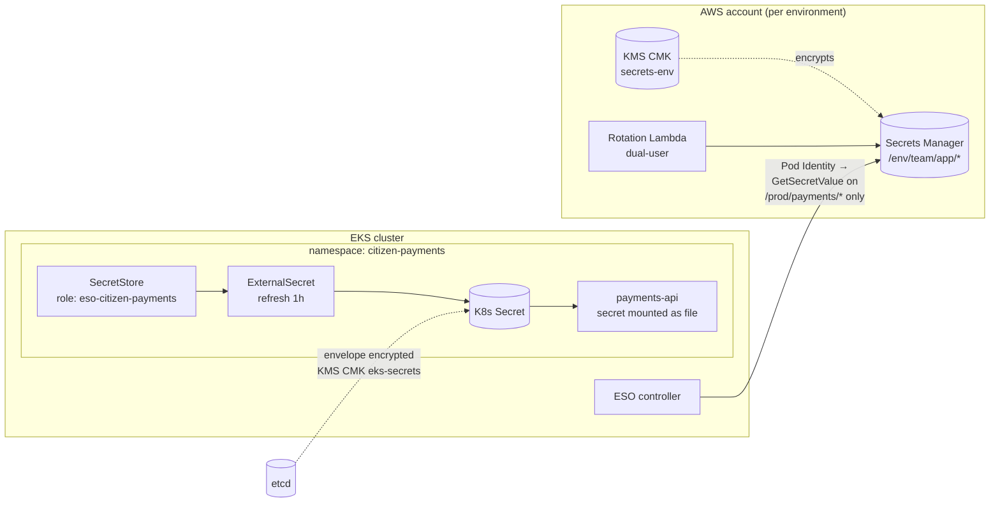

# Secrets & Key Management Architecture (Module 5)

## 1. What's wrong today

Secrets are base64 values in Git (F-11), baked into images (F-05), injected as environment variables, stored in etcd without a customer-managed key (F-23), and readable namespace-wide through over-broad RBAC (F-08). There's no single place to answer "where is this credential used, who read it, and when was it last rotated?"

## 2. Options compared

| | **A. External Secrets Operator + cloud secrets manager** | **B. HashiCorp Vault (or OpenBao)** | **C. Sealed Secrets / SOPS (encrypted in Git)** |
|---|---|---|---|
| How it works | ESO controller reads from AWS Secrets Manager (later Azure Key Vault / GCP Secret Manager) and writes a K8s Secret | Central Vault cluster; pods get secrets via Vault Secrets Operator, Agent sidecar or CSI | Secret encrypted with a cluster key (Sealed Secrets) or KMS key (SOPS), committed to Git, decrypted in-cluster |
| Run cost | Low: managed backend, one stateless controller | **High**: HA cluster, storage, unseal, upgrades, DR, on-call. Becomes a tier-0 service. | Low |
| Rotation | Backend rotates (Secrets Manager rotation Lambdas, RDS integration); ESO syncs on an interval | Best in class: **dynamic secrets** (per-pod DB credentials with a TTL), leases, revocation | Manual: re-encrypt and commit. Rotation competes with release cadence, so in practice it doesn't happen. |
| Audit of access | CloudTrail on every `GetSecretValue` | Vault audit log, very detailed | Git history shows *changes*, not *reads* |
| Multi-cloud | Same `ExternalSecret` API everywhere; backend differs per cloud | **One backend for all clouds** | SOPS works with each cloud's KMS; Sealed Secrets keys are per cluster |
| Licensing | Apache 2.0 + cloud service | Vault is BSL since 2023 (and now IBM-owned); OpenBao is the open-source fork | Apache 2.0 / MPL |
| Failure mode | Backend down → existing K8s Secrets keep working; only refresh stops | Vault down → pods that fetch at start-up can't start. Needs very high availability. | None at runtime |
| Fit before go-live | **Good**: weeks | Poor: months to run Vault well | Good, but doesn't solve rotation or audit |

**What each is honestly best at:**
- **A** is the fastest way to get secrets out of Git with audit and managed rotation, and it builds on IAM we already have.
- **B** is the right answer if the programme needs dynamic, short-lived credentials across many clouds and has a team to run Vault as a product. It's the strongest model and the most expensive.
- **C** is good for the small set of *bootstrap* secrets that must exist before anything else (e.g. ESO's own config in a cluster with no cloud identity yet). It's a poor general answer because rotation and read-audit are weak.

## 3. Recommendation

**External Secrets Operator with AWS Secrets Manager now, with the backend deliberately kept swappable.**

- Applications only ever see `ExternalSecret` resources and mounted files. They never call a cloud API for secrets and never know which backend is behind them.
- Backend choice lives in one `SecretStore` per namespace, owned by the platform team.
- **Decision point at AKS/GKE onboarding:** if secrets need to be shared across clouds, or dynamic credentials become a requirement, stand up Vault/OpenBao and repoint the `SecretStore`s. ESO supports Vault as a provider, so application manifests don't change. If not, use each cloud's native manager behind the same ESO interface.

That's the honest answer to "no different backend per cloud": the *interface* is the same on every cloud from day one; whether the *backend* is unified is a cost decision we can make with real data in two quarters, without rework.

**Where RDS supports it, the best secret is no secret:** IAM database authentication via Pod Identity removes the password entirely. That's the first thing to try for each database connection; Secrets Manager is for what's left.

## 4. Design



**Multi-tenancy.** One `SecretStore` *per namespace*, each using its own IAM role, scoped to that team's path (`/prod/payments/*`). Not one cluster-wide `ClusterSecretStore`. With a single cluster-wide store, any team that can create an `ExternalSecret` can pull any other team's secret into their own namespace. This is a common ESO mistake and it recreates F-08 at the cloud layer.

**Delivery to the pod:**
- **Mounted as files, not environment variables.** Files can update in place (below); env vars can't, and they leak through `/proc`, crash dumps and child processes (F-11).
- Never with `subPath` mounts, which don't receive updates.
- `automountServiceAccountToken: false` on application pods, since they don't need the Kubernetes API to read their secrets.

**K8s Secrets still exist** (ESO writes them), so the in-cluster controls still matter: envelope encryption with a CMK (F-23), RBAC so only the workload's own SA can `get` its secret and nobody can `list` (F-08), and the Falco audit rule for secret listing (Module 3). The Secrets Store CSI Driver avoids the K8s Secret entirely by mounting straight from the backend; it's a reasonable alternative for the most sensitive values, at the cost of a hard runtime dependency on the backend at pod start.

## 5. Rotation without a manual restart cycle

Rotation fails in practice when it causes outages, because then people stop rotating. The design avoids that:

1. **Dual credentials.** Secrets Manager's alternating-users rotation keeps two valid credentials (`AWSCURRENT` and `AWSPREVIOUS`) and rotates them in turn. During propagation, both work, so no request fails.
2. **ESO picks up the new value** on its `refreshInterval` (1 hour by default; shorter for credentials with short validity) and updates the K8s Secret.
3. **Kubelet updates the mounted file** in running pods automatically (within its sync period, typically about a minute). No restart.
4. **The application re-reads the file.** Either on each new connection, or by watching the file. Most connection pools and frameworks can do this with a small change.
5. **For applications that can't re-read** (including, likely, the COTS product): **Stakater Reloader** watches the Secret and triggers a *rolling* restart of the Deployment. That respects PDBs and readiness probes, so it's a zero-downtime rollout, not a manual restart cycle.
6. **Verification:** the rotation Lambda's final step tests the new credential; a CloudWatch alarm fires if any secret is older than its rotation policy allows.

Rotation cadence: database and service credentials every 30 days; third-party API keys per provider capability (90 days or on staff change); the image-signing key yearly. KMS automatic rotation only works for symmetric keys and the signing key is asymmetric, so that one is a planned change: a new key behind the same alias, with the old public key kept in the Kyverno policy until images signed with it age out.

## 6. Key hierarchy and root of trust

```
AWS KMS HSMs (FIPS 140-3 validated)              ← root of trust; AWS-operated, keys never leave
 └─ Customer-managed keys, one per purpose per environment
     ├─ eks-secrets-<env>        envelope-encrypts K8s Secrets in etcd (F-23)
     ├─ secretsmanager-<env>     encrypts Secrets Manager entries
     ├─ ci-image-signing         Cosign signing key (asymmetric, sign/verify only)
     ├─ log-archive              central logs, forensic evidence bucket
     └─ ebs-<env>, rds-<env>     volumes, snapshots, backups (Module 12)
         └─ Data keys (envelope encryption, generated per object, never stored in plaintext)
```

**Who can touch what (key policies, not just IAM):**

| Role | Can | Can't |
|---|---|---|
| Key administrators (security team) | Create, rotate, change policy, schedule deletion | Encrypt or decrypt with the key |
| EKS cluster role | Encrypt/decrypt with `eks-secrets-<env>` only | Anything else |
| ESO role, per namespace | Decrypt via Secrets Manager for its own path only (`kms:ViaService` condition) | Call KMS directly |
| CI signing role | `kms:Sign` on `ci-image-signing`, only from protected-branch pipelines | Decrypt anything |
| Break-glass | Documented, dual-control, alarmed on use | |

Separation of duties: nobody can both administer a key and use it. Key-policy changes, `DisableKey` and `ScheduleKeyDeletion` alarm to the security team immediately; deletion has a 30-day waiting period.

**If data classification requires keys outside AWS's custody** (to be confirmed against the actual standard): AWS KMS External Key Store (XKS) or CloudHSM-backed custom key stores keep the same KMS API, so nothing above changes except the key store setting.

## 7. Across clouds

| | AWS | Azure | GCP |
|---|---|---|---|
| Application manifest (`ExternalSecret`, file mount) | same | same | same |
| `SecretStore` provider | `aws` (Secrets Manager) | `azurekv` | `gcpsm` |
| Workload → backend identity | EKS Pod Identity | AKS Workload Identity | GKE Workload Identity Federation |
| Root of trust | AWS KMS | Azure Key Vault Managed HSM | Cloud KMS / Cloud HSM |
| etcd envelope encryption | EKS + KMS | AKS KMS etcd encryption | GKE application-layer secrets encryption |

If the Vault/OpenBao route is chosen at the decision point, it sits above all three with auto-unseal from one cloud's KMS, and the `SecretStore` provider becomes `vault` everywhere. Application manifests are unchanged either way.
