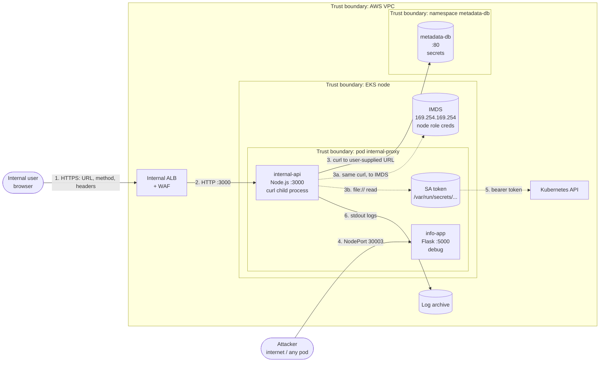

# Threat Model: `internal-proxy` workload (Module 8)

## 1. Scope and method

**Workload:** `internal-proxy` from kubernetes-goat ([`scenarios/internal-proxy/deployment.yaml`](https://github.com/madhuakula/kubernetes-goat/blob/723a0db478f050d173d23b4ce5044b65bce0bdd0/scenarios/internal-proxy/deployment.yaml)). One pod with two containers:
- `internal-api` (Node.js, port 3000): takes a URL, method and headers from the user, fetches it with `curl`, and returns the response ([`server.js`](https://github.com/madhuakula/kubernetes-goat/blob/723a0db478f050d173d23b4ce5044b65bce0bdd0/infrastructure/internal-api/code/server.js));
- `info-app` (Flask, port 5000): returns a hint pointing to `metadata-db`, exposed on NodePort 30003 in debug mode.

Its backend is `metadata-db` (Go, port 80), which serves a metadata tree that includes secrets. On EKS, the cloud instance metadata service (IMDS) at `169.254.169.254` sits in the same position.

**Why this one:** it's the workload where an application bug, a platform gap and a cloud-identity gap meet (attack chain C in Module 1), so it shows how the controls from Modules 2–5 combine.

**Method:** STRIDE per element of the data flow diagram. Likelihood and impact are rated High / Medium / Low:
- **Likelihood:** *High* = reachable by an unauthenticated or low-skill attacker with public techniques. *Medium* = needs a foothold or specific knowledge. *Low* = needs an unpublished vulnerability or insider access.
- **Impact:** *High* = credentials or data outside this workload, or the node/cluster. *Medium* = this workload's data or availability. *Low* = nuisance.

Both are rated **as the workload stands today**; the residual column is the rating **after the proposed controls**.

## 2. Data flow diagram

Dashed lines are flows that exist only because of a weakness. In the target state they're blocked.

## 3. Threats

| ID | STRIDE | Element / flow | Threat | L | I | Control (✓ existing, ➕ proposed) | Residual |
|---|---|---|---|---|---|---|---|
| T1 | **S**poofing | Flow 1 → `internal-api` | No authentication: anyone who can reach the API is treated as a legitimate internal user. | High | High | ➕ ALB OIDC authentication against the agency IdP; ➕ NetworkPolicy ingress only from ALB subnets ([networkpolicies.yaml](../06-remediation/fixed-manifests/networkpolicies.yaml)) | Low |
| T2 | **S**poofing | Flow 3 → `metadata-db` | `metadata-db` trusts any caller on the network, so anything that can make `internal-api` send a request can impersonate it. | High | High | ➕ `metadata-db` requires a per-client token (later mTLS, Module 4); ➕ NetworkPolicy: only `internal-api` may connect | Medium (see T6) |
| T3 | **T**ampering | Flow 3 | User controls the HTTP method and headers, so they can send `PUT`/`DELETE` or inject headers to change backend data. | Medium | Medium | ➕ Code: fixed `GET` only, no user-supplied headers; ➕ `metadata-db` read-only API | Low |
| T4 | **T**ampering | Image supply | Images referenced without a tag from a personal Docker Hub namespace; whoever controls the tag controls what runs (F-17). | Medium | High | ➕ ECR mirror, digest pinning, Cosign signature verified by Kyverno at admission | Low |
| T5 | **R**epudiation | `internal-api` | No access log of who fetched which URL; a misuse can't be traced to a person. | High | Medium | ✓ Container stdout is collected; ➕ structured access log with the authenticated user from the ALB OIDC header, URL fetched, response size; ➕ ALB access logs to the log archive | Low |
| T6 | **I**nformation disclosure | Flow 3 → `metadata-db` | **SSRF:** user supplies `http://metadata-db/latest/secrets/...` and gets secrets back (F-09). | High | High | ➕ Code: destination allowlist; ➕ secrets removed from `metadata-db` into Secrets Manager; ➕ egress NetworkPolicy | **Medium: not fully mitigated** (§4) |
| T7 | **I**nformation disclosure | Flow 3a → IMDS | SSRF to `169.254.169.254` returns the node IAM role's temporary credentials (F-19). | High | High | ➕ IMDSv2 required, hop limit 1; ➕ `169.254.169.254/32` excluded in egress policy; ➕ Pod Identity so the node role holds almost nothing; ➕ Falco `Pod Contacted Cloud Metadata Service` | Low |
| T8 | **I**nformation disclosure | Flow 3b → SA token | `curl` accepts `file://`, so `file:///var/run/secrets/kubernetes.io/serviceaccount/token` returns the pod's Kubernetes token. | High | Medium | ➕ Code: only `http`/`https` schemes (`--proto =http,https`); ➕ `automountServiceAccountToken: false` (nothing to steal); ➕ Falco `Unexpected Read of Service Account Token` | Low |
| T9 | **I**nformation disclosure | Flow 4 → `info-app` | Flask debug mode on a NodePort exposes stack traces and the Werkzeug debugger console (F-10). | High | High | ➕ `debug=False`, gunicorn; ➕ ClusterIP only; Kyverno blocks NodePort | Low |
| T10 | **D**enial of service | `internal-api` | `spawnSync` blocks Node.js's single event loop. One request to a slow or never-ending URL hangs the whole service for every user. No timeout, no response size cap. | High | Medium | ✓ CPU/memory limits exist; ➕ async fetch with 5s timeout and 1 MB cap; ➕ WAF rate limit per client; ➕ 2+ replicas with PDB | Low |
| T11 | **E**levation of privilege | `internal-api` → container | **Argument injection:** the URL is passed to `curl` as an argument, so a value starting with `-` is read as a curl option (e.g. writing output to a file). With a writable filesystem running as root, that can overwrite application files, which leads to code execution in the container. | Medium | High | ➕ Code: parse as URL, reject leading `-`, pass `--` before the URL; ➕ `readOnlyRootFilesystem`, non-root (F-20); ➕ PSA `restricted` | Low |
| T12 | **E**levation of privilege | Container → node | Once code runs in the container, a kernel or runtime vulnerability allows escape to the node and every pod on it. | Low | High | ➕ seccomp `RuntimeDefault`, all capabilities dropped, non-root, no host mounts (PSA `restricted`); ➕ user namespaces where supported; ➕ monthly node replacement with patched AMIs; ➕ Falco escape rules | **Low-Medium: not fully mitigated** (§4) |

Coverage: S ×2, T ×2, R ×1, I ×4, D ×1, E ×2. Information disclosure dominates, which fits a workload whose job is fetching things on a user's behalf.

## 4. What the controls don't fully cover

**T6: SSRF to a backend `internal-api` is *allowed* to call.** NetworkPolicy and the code allowlist shrink "anything" down to "`metadata-db` on port 80". But that is the one place it needs to reach. If a user can choose the *path* on that backend, an allowlist of hosts doesn't stop them reading paths they shouldn't. The full fix is on the `metadata-db` side: move secrets out of it entirely and have it authorise per caller and per path. That's a change to a second team's service and won't land before go-live.
**Residual: Medium**, owned by the `internal-api` service owner. Accept with conditions: the access log (T5) records every path fetched, and a SIEM alert fires on any request to `/latest/secrets/*`.

**T12: Container escape via an unknown kernel vulnerability.** Every control here reduces the chance or the impact, but none removes it: by definition we can't patch an unknown vulnerability. User namespaces would make a successful escape land as an unprivileged user, but that depends on the node image (Module 7).
**Residual: Low-Medium**, owned by the platform team. Inherent to shared-kernel containers. If a future workload's data classification can't accept it, the answer is stronger isolation for that workload (a dedicated node group, or a sandboxed runtime such as gVisor or Kata), not more controls on this one.

## 5. How this connects to the rest of the pack

| Threat | Finding | Where the control is designed |
|---|---|---|
| T1, T2 | F-12 | Module 4, NetworkPolicy and ingress |
| T4 | F-17 | Module 2, signing and admission |
| T6, T7, T8 | F-09, F-19, F-27 | Modules 4 and 5, egress and workload identity; Module 3, detection rules |
| T9 | F-10 | Module 2, Kyverno NodePort rule |
| T11, T12 | F-20, F-06 | Module 6, fixed manifests and PSA |
