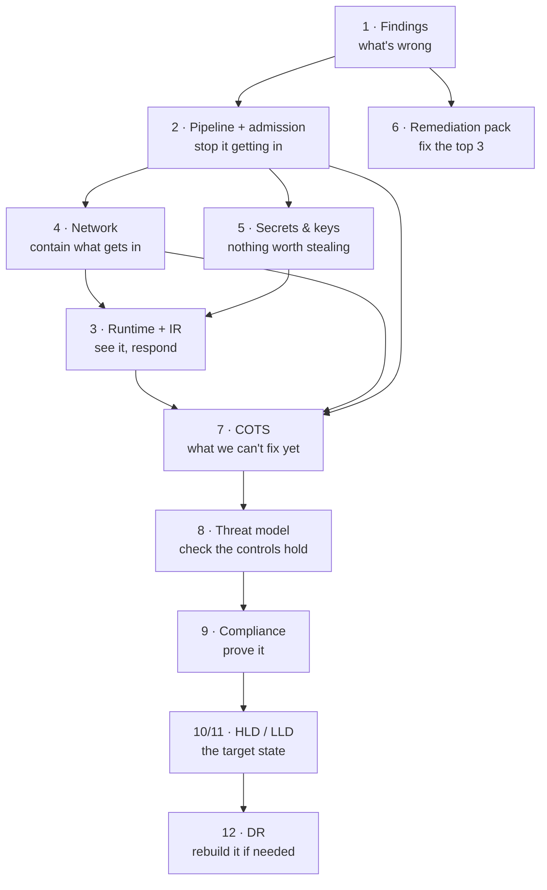

# DevSecOps Assessment: Track 1, Kubernetes & Container Security

Security review and target-state design for a Kubernetes estate (EKS today, with AKS and GKE on the roadmap), done against a public, intentionally vulnerable reference repository. No real environment was accessed; every finding comes from the public repositories listed below.

## Executive summary

**Overall posture: not ready for go-live as it stands. Ready within the window: close the 10 blockers first, then put four platform controls in before go-live.**

The review found **31 issues: 4 Critical, 14 High, 11 Medium, 2 Low** ([findings register](01-findings/findings-register.md)). In plain terms:

1. **Too much power in the wrong places.** A build pipeline account holds the cluster's master key (the same pattern as the internal audit finding), and several applications run with full control of the servers underneath them. Any one of these, if misused, gives an attacker the whole cluster.
2. **Nothing checks what goes in.** There's no automatic gate that stops a dangerous configuration from being deployed, and no check that the software running is the software we built.
3. **Nothing separates applications from each other.** Every application can talk to every other one, and passwords are stored in places many people and systems can read.
4. **We wouldn't know.** Audit logging is off and there's no runtime detection, so misuse would be found by the next audit rather than by an alert.

**What I recommend:** fix the 10 go-live blockers (about 12 engineer-days), and put in four platform controls that close most of the rest across every workload at once, rather than application by application:

| Control | Closes | Module |
|---|---|---|
| Policy gates in the pipeline + admission control in the cluster | Dangerous configurations can't be merged or deployed, including the cluster-admin binding | [2](02-pipeline-supply-chain/pipeline-design.md) |
| Signed, pinned images from our own registry | We know exactly what runs, and nobody can swap it | [2](02-pipeline-supply-chain/pipeline-design.md) |
| Default-deny networking + per-workload cloud identity | One compromised app can't reach the others or the cloud account | [4](04-network-mesh/zero-trust-design.md), [5](05-secrets-keys/secrets-architecture.md) |
| Audit logging + runtime detection to a tamper-proof archive | Misuse raises an alert, and the evidence survives | [3](03-runtime-security/runtime-detection-ir-plan.md) |

**One decision for the panel:** the COTS product that the vendor won't rebuild can go live with compensating controls at a **Medium** residual risk. That acceptance should be signed by the **system owner**, endorsed by the ITSO-equivalent, valid for 6 months, with a funded exit plan ([Module 7](06-remediation/compensating-controls.md)). A second, smaller decision is in [Module 12](10-resilience-dr/dr-plan.md#4-named-rto--rpo-payments-api-citizen-payments): whether data-residency rules allow a second-region DR copy.

## The first 90 days

| Weeks | Focus | Main actions |
|---|---|---|
| 1–2 | Blockers | Confirm these findings against the real estate with the delivery teams; remove the cluster-admin binding and scope CI to its namespaces; remove privileged and host-access pods; rotate exposed secrets; turn on audit logging; Pod Security in warn mode everywhere |
| 3–6 | Platform, then go-live | Policy gates and admission from audit to enforce (Pod Security enforcing `baseline`, which already blocks privileged pods and host access, and warning on `restricted`); default-deny networking namespace by namespace; Pod Identity and IMDSv2; secrets into Secrets Manager; image signing; COTS controls and signed risk acceptance |
| 7–12 | Prove and harden | GitOps cut-over so CI loses cluster access entirely; Falco paging on; soft gates and Pod Security `restricted` ratchet to enforce; first cluster rebuild drill and database restore test; run the same policies against a test AKS/GKE cluster |

Measured by: blockers closed with evidence, share of namespaces at default-deny and Pod Security `restricted`, time to detect a test cluster-admin binding, and measured rebuild time against the 2-hour target.

## Reference repositories

| Role | Repository | Pinned commit |
|---|---|---|
| **Primary review target** | [madhuakula/kubernetes-goat](https://github.com/madhuakula/kubernetes-goat) | `723a0db` |
| **Supplementary** (EKS and ECR Terraform) | [bridgecrewio/terragoat](https://github.com/bridgecrewio/terragoat): `terraform/aws/eks.tf`, `ecr.tf` only | `729f8da` |
| **"What good looks like"** baseline for remediation and diagrams | [aws-ia/terraform-aws-eks-blueprints](https://github.com/aws-ia/terraform-aws-eks-blueprints) | referenced, not reviewed |

**Why this combination:** kubernetes-goat covers the cluster and workload layers well (RBAC, pod security, secrets, network, supply chain), but it contains no Terraform. Its only provisioning code is an AWS CDK stack for a lab VM. The brief asks for findings across Terraform/cluster provisioning too, so two files from terragoat provide the EKS control-plane and registry findings (public endpoint, authentication, logging, secrets encryption key, ECR). Every finding cites `file:line` at the pinned commit, so the evidence stays valid if upstream changes.

## How the modules fit together

The modules tell one story: **find → prevent → contain → detect → decide → design → recover.**

- Every finding ID (F-01 to F-31) is used consistently: in the pipeline policies (each rule names the finding it prevents), the Falco rules, the threat model, the compliance mapping and the slides.
- The **COTS recommendation (Module 7)** reuses the admission, network and runtime designs rather than inventing separate controls.
- The **threat model (Module 8)** checks the earlier designs against one workload and states openly where they fall short.
- **Where the managed-Kubernetes line sits** (provider vs us, and how it differs on EKS, AKS and GKE) is in the [architecture narrative](09-architecture/architecture-narrative.md#shared-responsibility-where-the-line-sits-on-eks-aks-and-gke).

## Navigating the repo

| Folder | Module | Contents |
|---|---|---|
| [`01-findings/`](01-findings/) | 1 | [Findings register](01-findings/findings-register.md) (31 findings, attack chains), [severity methodology](01-findings/severity-methodology.md), [scanner evidence](01-findings/evidence/) |
| [`02-pipeline-supply-chain/`](02-pipeline-supply-chain/) | 2 | [Pipeline design](02-pipeline-supply-chain/pipeline-design.md), [`.gitlab-ci-example.yml`](02-pipeline-supply-chain/.gitlab-ci-example.yml), [Conftest policy](02-pipeline-supply-chain/policies/conftest/kubernetes.rego), [Kyverno policies](02-pipeline-supply-chain/policies/kyverno/cluster-guardrails.yaml), [image verification](02-pipeline-supply-chain/policies/kyverno/verify-images.yaml), [Semgrep org rules](02-pipeline-supply-chain/policies/semgrep/org-rules.yaml) |
| [`03-runtime-security/`](03-runtime-security/) | 3 | [Detection and IR plan](03-runtime-security/runtime-detection-ir-plan.md), [custom Falco rules](03-runtime-security/falco-rules-custom.yaml) |
| [`04-network-mesh/`](04-network-mesh/) | 4 | [Zero-trust network design and mesh decision](04-network-mesh/zero-trust-design.md) |
| [`05-secrets-keys/`](05-secrets-keys/) | 5 | [Secrets and key architecture](05-secrets-keys/secrets-architecture.md) |
| [`06-remediation/`](06-remediation/) | 6, 7 | [Remediation advisory](06-remediation/remediation-advisory.md), [COTS compensating controls](06-remediation/compensating-controls.md), [fixed manifests](06-remediation/fixed-manifests/) |
| [`07-threat-model/`](07-threat-model/) | 8 | [STRIDE threat model](07-threat-model/threat-model.md) |
| [`08-compliance/`](08-compliance/) | 9 | [Compliance mapping](08-compliance/compliance-mapping.md) |
| [`09-architecture/`](09-architecture/) | 10, 11 | [HLD](09-architecture/hld-diagram.svg), [LLD](09-architecture/lld-diagram.svg), [narrative](09-architecture/architecture-narrative.md) |
| [`10-resilience-dr/`](10-resilience-dr/) | 12 | [DR plan](10-resilience-dr/dr-plan.md) |
| [`11-presentation/`](11-presentation/) | | Slides (PDF) for the panel |
| [`tools/`](tools/) | | Scripts that reproduce all the scanner and live-cluster evidence (`run-scans.sh` offline; `run-online-checks.sh` for the two tools that download schemas and rules) |

## How the review was done, and how it was done safely

- **Manual review first.** All manifests, Dockerfiles, scripts and the relevant application code were reviewed by hand. Scanners were used afterwards to cross-check, and the coverage note in [`01-findings/evidence/`](01-findings/evidence/) shows what each one caught and missed.
- **Policies and fixes were tested, not just written.** The pipeline and admission policies were run against the real goat manifests and against the corrected manifests, and the Module 6 fixes were checked on a throwaway local cluster. Testing and a final review caught a bug in my own admission policy, a wrong check ID, an overstated Semgrep claim, a pipeline job whose image couldn't have run it, and two findings the manual review missed; all are listed in the [evidence README](01-findings/evidence/README.md#what-testing-changed-in-the-submission).
- **No vulnerable workload ever ran.** kubernetes-goat's setup scripts deploy privileged pods and web shells, and its access script exposes them on all network interfaces. Neither script was run. The live test applied goat's manifests only to a throwaway local cluster, with every image reference replaced by an unresolvable registry, and Pod Security refused the pods. The repo was cloned into an isolated folder with Git hooks disabled.
- **Scanners were treated as untrusted too.** In March and April 2026, the Trivy and KICS Docker Hub images were replaced with credential-stealing versions. So every scanner here ran from an image **pinned by digest**, against **read-only** mounts, with **no credentials** in reach and **no network access**, except the two checks that have to download schemas or rule packs (kubeconform and Semgrep's registry rules), which are kept in a separate script. Exact images and commands are in the evidence folder.
- **No secrets in this repo.** The reference repo contains fake credentials; this repo cites their locations only and never copies the values.

## Use of AI

AI assistance (Claude) was used, as permitted for this assessment, for research, drafting, test automation and diagram layout. I reviewed the findings against the source at the pinned commits, and the scoping, prioritisation, design decisions and trade-offs are mine.
